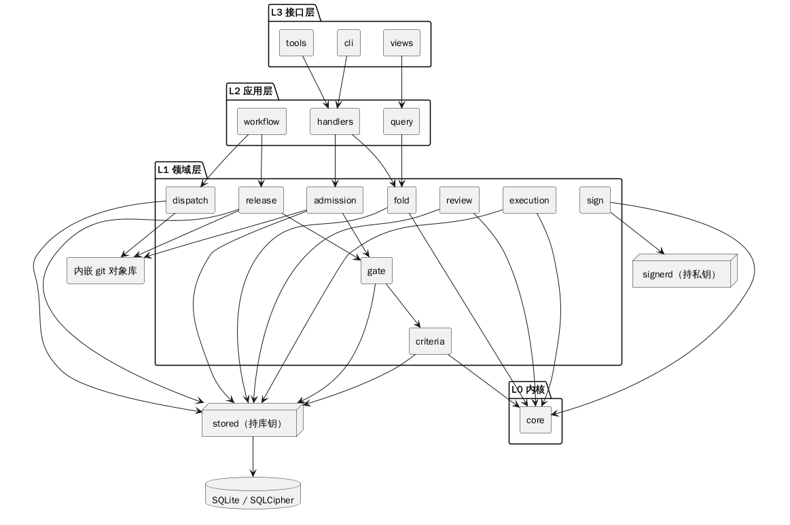

# 结构化设计：分层、模块与接口

> 输入：`docs/`（概念、判据、不变量）与 `probe/`（哪些约束库能表达）。
> 本文只决定**边界与依赖**，不决定类与算法（那是 [02-面向对象模型](02-面向对象模型.md)）。

## 1. 分层

```text
L3 接口层   tools（模型面三个工具） · cli（人类命令） · views（查询面）
              ↓ 只能调用 L2
L2 应用层   command handlers（两段式） · query handlers · workflow（阶段推进）
              ↓ 只能调用 L1
L1 领域层   domain services：fold / criteria / gate / admission / dispatch / sign
              ↓ 只能调用 L0
L0 内核     entities · value objects · invariants · errors（纯逻辑，无 I/O）
```

**依赖规则（可机械检查）**

1. L0 不 import 任何其他层，也不 import 数据库、文件、网络、时钟；
2. L1 只依赖 L0 与端口接口，不知道具体实现；
3. L2 负责编排与事务边界，**不写业务规则**；
4. L3 不做判断，只做参数校验、权限裁剪与渲染。

违反任一条 ⇒ 评审退回。理由：`probe` 已证明多数约束不能靠数据库，规则必须集中在**能测的层**。

## 2. 组件与依赖（一张图）



> 图源：`diagrams/arch-components.puml`。L0 只依赖 core 自身；L1 通过端口访问 `stored`（持库钥）与内嵌 git；L3 不得越过 L2。

## 3. 模块清单

| 模块 | 职责 | 依赖 | 来源 |
|---|---|---|---|
| **core** | 实体、值对象、不变量、错误类型 | 无 | `01` 概念表 |
| **store**（经 `stored` 进程） | 事件追加、投影更新、事务与单写 | core, ports | `02` |
| **fold** | 事件 → 状态；前沿计算；快照一致性校验 | core | `02` |
| **criteria** | 判据注册、夹具执行、变异自证 | core, store | `04` |
| **admission** | 准入：lease/范围/diff/判据的编排与拒绝 | core, gate, vcs | `07` |
| **handlers** | L2 编排：两段式写、权限裁剪（不含业务规则） | L1 服务 | `11` |
| **query** | L2 编排：查询投影的入口（`views` 只调用它，不直连 L1） | fold | `05` |
| **workflow** | L2 编排：阶段推进、交付顺序 | L1 服务 | `13` |
| **gate** | 门禁判定（`all_of`/`any_of`，`na` 语义）、baseline 冻结与方向判定 | core, criteria | `04` |
| **vcs**（内嵌 git 对象库） | 内嵌 git 对象库、快照读写、工作副本检出、三路合并 | core, ports(fs) | `03`, `08` |
| **dispatch** | 派发、lease、复用判定、代理状态 | core, store, vcs | `12` |
| **review** | 评审轮、发现核实、非作者判定 | core, store | `03`, `13` |
| **sign** | 凭据、签名请求、decision 落库（独立进程） | core, ports(signer) | `06` |
| **release** | 冻结、缺口差集、打包绑快照、回滚 | core, gate, vcs, sign | `09` |
| **execution** | 任务生命周期、`report`、`attention`、`block` | core, store | `03`, `05` |
| **views** | 只读投影与查询、`query_miss` 记录 | core, store | `05` |
| **tools** | 模型面三个工具、`preview/confirm/cancel` | L2 handlers | `05`, `11` |
| **cli** | 人类命令（导出、备份、迁移、验收） | L2 handlers | `02`, `09` |

**没有来源的模块不许存在**；上表每一行都在 `docs/` 里有对应概念或判据。

## 4. 端口与适配器

| 端口 | 用途 | 适配器（可替换） |
|---|---|---|
| `Database` | 事件与投影的持久化 | SQLite（默认）/ Postgres（T2） |
| `Vcs` | 快照对象库、检出、合并 | 内嵌 git（纯 JS） |
| `Clock` | 所有时间戳（禁止直接取系统时间） | 系统时钟 / 测试时钟 |
| `IdGen` | 所有 id（禁止自增暴露业务含义） | 单调 ULID / 测试序列 |
| `Hasher` | 规范化哈希（内容、前沿、payload） | SHA-256 |
| `Signer` | 签名与验签 | 独立进程（私钥不在插件内） |
| `Diagnostics` | 结构化日志（不含结论文字） | 本地文件 / 宿主面板 |

L0 与 L1 只认端口，**不认实现**——这是 `probe` 那条教训的制度化：凡是"库拦不住"的东西，必须有一个可替换的端口来兜。

## 5. 过程与协作写在哪（避免与另两篇重复）

本节**不再重复画流程**，只做指路——同一逻辑只允许一种表达：

| 要看的 | 去哪 |
|---|---|
| 对象状态怎么变 | [02-面向对象模型](02-面向对象模型.md) 的状态图（Task / Agent / StageRun / ReviewRound） |
| 对象之间怎么协作 | [02](02-面向对象模型.md) 的顺序图（认领、准入、评审、交付、变更重开） |
| 一个动作内部怎么判断/循环 | [03-过程逻辑](03-过程逻辑.md)（流程图 / N-S 图 / PAD 图 / 判定表·树） |

**所有写操作的骨架相同**（细节在 03 的 P3）：

```text
参数校验 → 权限与范围 → preview(算 will_change + payload_hash)
→ confirm(payload_hash + frontier) → 领域校验 → 事务内追加事件 + 投影 → 回执
```

## 6. 事务与并发

| 场景 | 规则 |
|---|---|
| 事件写入 | 单写事务；第二个写者立即失败（`probe` 已验证 `database is locked`） |
| 投影更新 | 与事件**同一事务**，否则违反 L1 |
| 快照创建 | 与 `task.done` 事件同事务；快照对象先落盘、后提交引用 |
| 并发卡 | 每卡独立 gitdir（不共享 index）；锁按路径前缀 |
| 跨进程 | 只有 `sign` 与 `stored` 两个独立进程；其余在同进程内（`stored` 是 SQLCipher 的持钥进程，[02](../docs/02-真源-存储事件与折叠.md) 默认开） |

## 7. 错误模型（三种，不许混）

| 类型 | 含义 | 表现 |
|---|---|---|
| **拒绝（reject）** | 违反不变量/权限/范围 | 不落业务事件，落 `*.rejected(reason_code)`；调用方拿到 code |
| **失败（fail）** | 执行出错（I/O、外部进程） | 可重试；重试用尽 ⇒ `blocked(failed)` + `attention` |
| **缺口（gap）** | 设计未决定或数据缺失 | 记 `gaps`，**不得用默认值静默通过** |

`probe` 暴露的 5 个 GAP 就是第三类：未决期间走"兜底 + 记缺口"，绝不假装已定。

## 8. 配置与部署形态

| 形态 | 部署 | 差异 |
|---|---|---|
| **T0 单人** | 同机三进程（插件 + `stored` + `sign`）+ 本地库 | `solo_cooldown` 独立性；**`stored` 与 `sign` 都不内嵌**（前者持库钥、后者持私钥），T0 只省人，不省进程 |
| **T1 小团队** | 单进程 + 共享库 | `dual_human`；`sign` 独立进程 |
| **T2 多租户** | 服务 + 独立库 | 每租户一库；`store` 独立用户 |

形态只改**装配**，不改领域代码——这是把 `03` 的"部署形态"落成分层约束的方式。

## 9. 与 GAP 的关系（未决项落在哪一层）

| GAP | 若选 A | 若选 B | 落点 |
|---|---|---|---|
| G1 父链 | 链接表（store 层） | 应用层校验（fold） | store / fold |
| G2 派生列 | 应用层重算（L2） | 触发器（store 适配器） | store / L2 |
| G3 注册门槛 | 写入路径（L1 criteria） | 触发器 | criteria |
| G4 一卡一行 | 表约束 | 判据 | store / gate |
| G5 kind 闭包 | 参考表 | 代码白名单 | store / tools |

## 10. 结构化设计的自检

- [ ] 每个模块都在 `docs/` 有来源；
- [ ] 分层依赖单向，L0 无 I/O；
- [ ] 每条不变量只有一个守卫点；
- [ ] 写路径统一走 preview/confirm；
- [ ] 三种错误类型没有混用；
- [ ] GAP 未决项都有兜底，且不静默通过。
