# 面向对象模型（OOM）

> 承接 [01-结构化设计](01-结构化设计.md)。本文只定义**对象、聚合、职责与协作**，不含代码。
> 原则：**聚合边界 = 事务边界**；值对象不可变；规则集中在聚合根与领域服务，不散落在 handler。
>
> **表达方式分工（防两边矛盾）**：
> - 对象**状态怎么变** → 本文的状态图（唯一处）；
> - 对象**怎么协作** → 本文的顺序图（唯一处）；
> - 动作**内部判断与循环** → [03-过程逻辑](03-过程逻辑.md)（唯一处）。
> 同一逻辑不在两处重复画。

## 1. 限界上下文

| 上下文 | 回答的问题 | 聚合根 |
|---|---|---|
| **意图** | 要什么、谁批的、依据哪版尺子 | `Intent`、`Spec`（`Restatement` 为聚合内实体） |
| **分解与工作** | 怎么切、谁做、做到哪 | `GoalNode`、`Task` |
| **验证** | 凭什么算过 | `Criterion`、`Gate`、`StageRun`、`Evidence` |
| **内容** | 代码是哪一版 | `Snapshot`、`WorkCopy` |
| **授权与决策** | 谁签的、签了什么 | `Decision`、`ReviewRound` |
| **派发** | 谁在做、能不能复用 | `Agent`、`Lease` |
| **配置** | 按哪把尺子判、能不能改 | `Baseline`（`Policy` 为值对象） |
| **交付** | 发布的是哪一版 | `Release` |

上下文之间**只通过 id 与端口**引用，不共享可变对象。

## 2. 类图

> 这是**核心类图**（聚合根 + 关键值对象 + 端口），不是 26 张表的全量类模型；表到类的映射**不另设一张总表**——表属于哪个上下文看 §1，表上的约束看 [docs/03](../docs/03-链条-意图到声明.md)，代码归属看 [01-结构化设计](01-结构化设计.md) 的模块表。
>
> **端口只画聚合直接依赖的那几个**（`EventStore` / `IntentRepository` / `SnapshotRepo` / `SignerPort` / `ClockPort`）；`DatabasePort` / `VcsPort` / `IdGenPort` / `HasherPort` / `DiagnosticsPort` 在 [01](01-结构化设计.md) §4 统一列，不在这里重复画。
>
> **哪些概念刻意不是类**（避免被读成遗漏）：`redteam` / `scenario` / `restatement_diff` / `report` / `receipt` / `scope_decl` 是**记录或值对象**，随所属聚合一起写，没有独立身份与生命周期（`Restatement` 例外：它有 id 与作废语义，是 **Intent 聚合内的实体**，见类图）；`baseline` 与 `policy` 以前也在这类里，但 P15 之后它们承担了"按哪把尺子判"的身份与签名，所以**升级为聚合根 + 值对象**（见 §1 的「配置」上下文）。`Task — WorkUnit` 为 **1:1**（G4 已定：`UNIQUE(task_id)`，一张卡要多条判据就拆卡）。

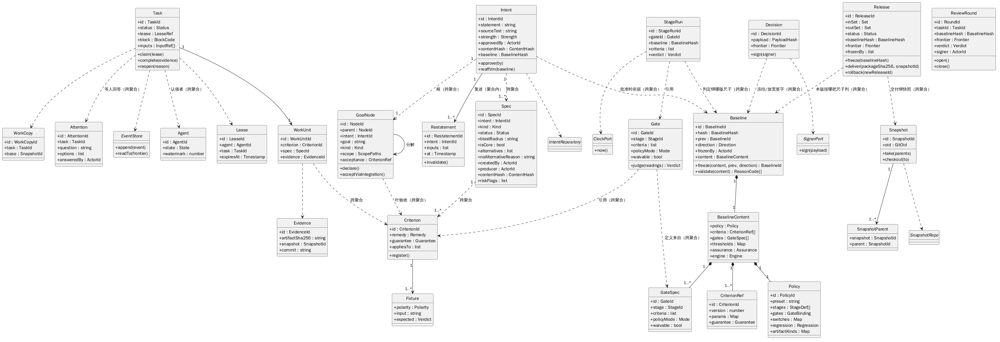

> 图源：`diagrams/uml-class.puml`

**类图的读法**：实线是**聚合内的强引用**（同一事务可改）；虚线是**跨聚合引用 / 仓储 / 端口**（只按 id 查，不共享可变对象）。跨聚合一律虚线——`Intent→Spec`、`Spec→Criterion`、`GoalNode→Criterion`、`WorkUnit→Criterion` 都在此列。

## 3. 状态图

> **只画有状态机的对象**。`Baseline` 没有状态机：每一行冻结后不可变，收紧/放宽都建新行（`prev` + `direction`），"当前用哪版"是**查询**（取最新已冻结行）而不是状态迁移。`Attention` 同理：`answered_by` 非空即已答，不需要独立状态枚举。把这类"用列/事件就能判"的东西画成状态图，会造出第二个状态源。

### 3.1 Task

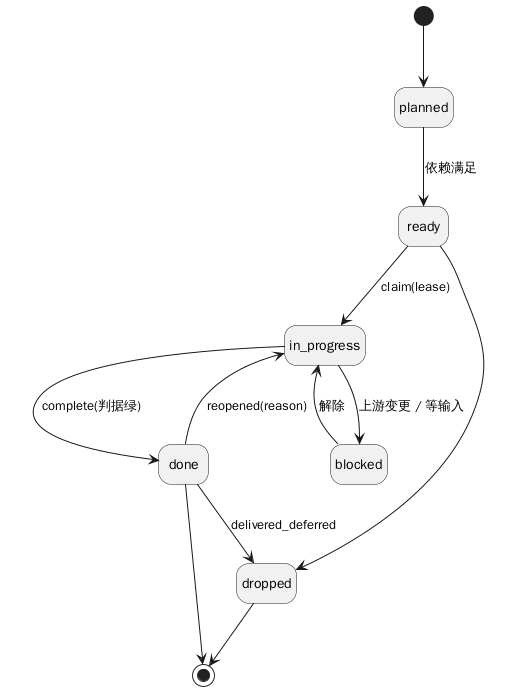

> 图源：`diagrams/uml-state-task.puml`

> `reopened` 是**事件**不是状态：它把 `done` 打回 `in_progress`，且必须走 `mandate.revalidated`。

### 3.2 Agent

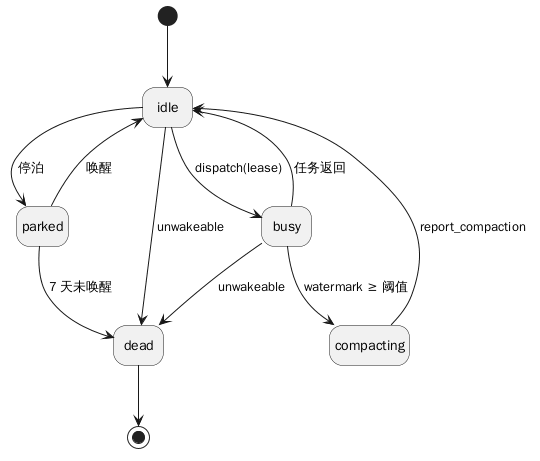

> 图源：`diagrams/uml-state-agent.puml`

> 只有 `unwakeable` 才 `dead`；`parked` 不算退役。

### 3.3 StageRun

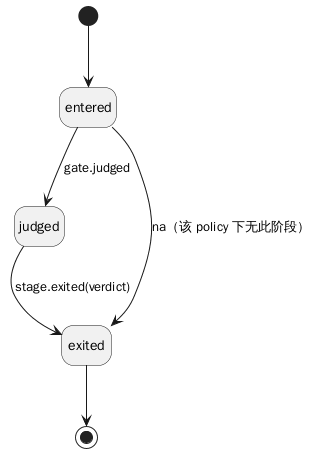

> 图源：`diagrams/uml-state-stagerun.puml`

> `verdict` 由 gate 读数算出；**三条路径都进 `closed`**（正常 `stage.exited`、`na`、失败收尾），没有任何“跳过 `closed`”的转移；`na` 只是 `verdict` 的一个取值。

### 3.4 ReviewRound

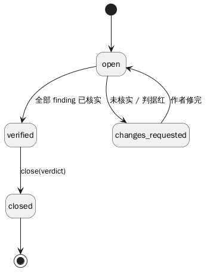

> 图源：`diagrams/uml-state-review.puml`

### 3.5 Release

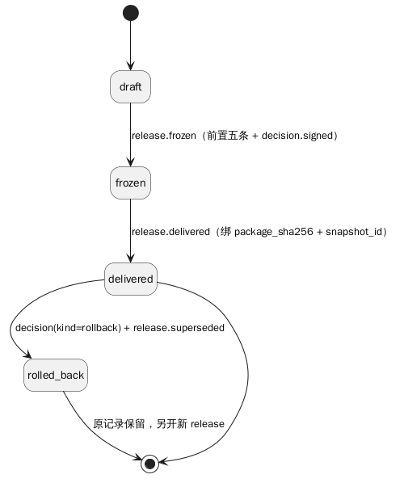

> 图源：`diagrams/uml-state-release.puml`。状态来自 `docs/09`（`draft | frozen | delivered | rolled_back`）；回滚不就地改回，另开新 release。

### 3.6 Criterion

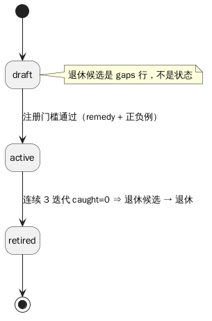

> 图源：`diagrams/uml-state-criterion.puml`。`draft → active` 的门槛是注册校验（含 G3）；**“退休候选”是 `gaps` 的一行，不是状态**。

### 3.7 Intent

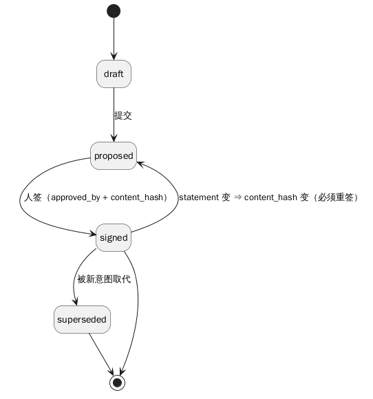

> 图源：`diagrams/uml-state-intent.puml`。状态来自 `docs/03`：`draft → proposed → signed → superseded`；`statement` 变 ⇒ `content_hash` 变 ⇒ 回 `proposed` 重签。

### 3.8 Spec

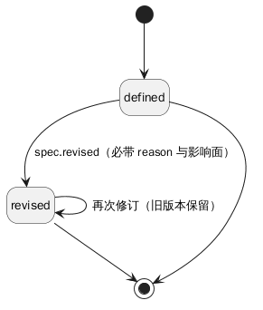

> 图源：`diagrams/uml-state-spec.puml`。`defined → revised*`，`revised` 必带 reason 与影响面；旧版本由 `design_lock` 保留。

### 3.9 Assumption（`spec(kind='assumption')` 的状态区）

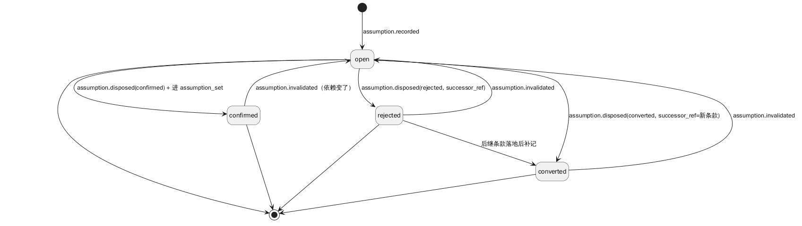

> 图源：`diagrams/uml-state-assumption.puml`。`open` 是入口；三条处置迁移**各有唯一生产者** `assumption.disposed(disposition=…)`；被依赖条款变更 ⇒ `assumption.invalidated` 回 `open` 并重签 `assumption_set`。**没有这张图时，`rejected`/`converted` 在文档里存在、在机制里不可达**。

## 4. 顺序图

### 4.1 认领 → 执行 → 完成

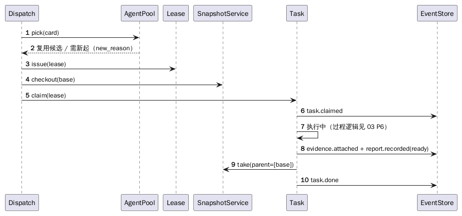

> 图源：`diagrams/uml-seq-claim.puml`

### 4.2 准入

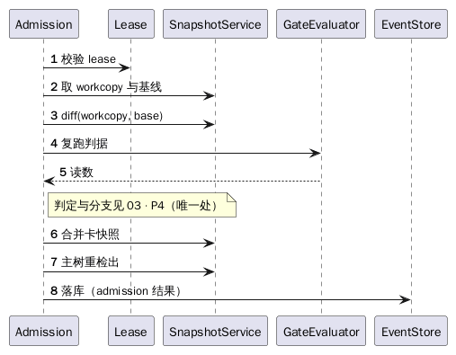

> 图源：`diagrams/uml-seq-admission.puml`

### 4.3 评审 → 裁定

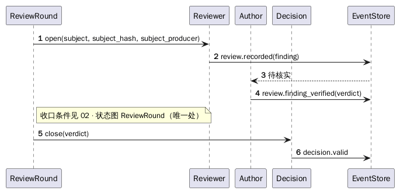

> 图源：`diagrams/uml-seq-review.puml`

### 4.4 交付

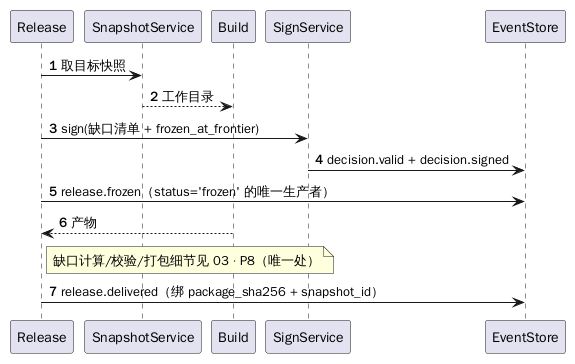

> 图源：`diagrams/uml-seq-release.puml`

### 4.5 变更重开

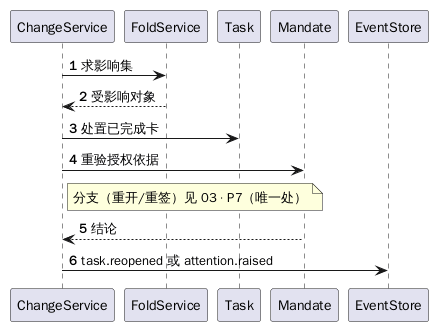

> 图源：`diagrams/uml-seq-change.puml`

### 4.6 配置冻结（P15）

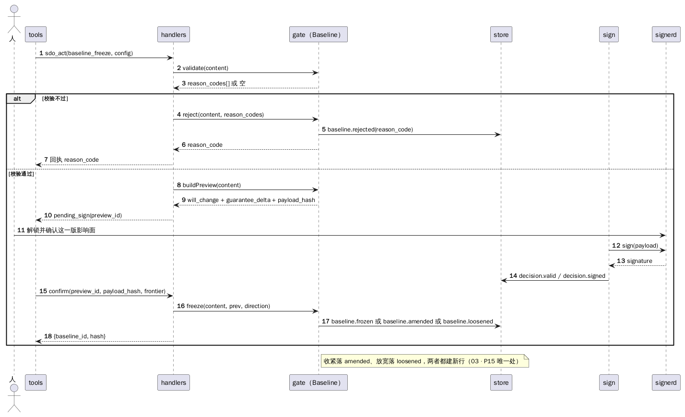

> 图源：`diagrams/uml-seq-config.puml`。校验不过就落 `baseline.rejected` 并返回；通过则 preview 出 `will_change + guarantee_delta + payload_hash`，人签 `decision(kind='baseline')`，confirm 之后才 `Baseline.freeze()`。**收紧落 `baseline.amended`、放宽落 `baseline.loosened`，两者都建新行**——所以这里没有"改状态"，只有"追加一行"。

### 4.7 对齐与假设处置（P11 / P12）

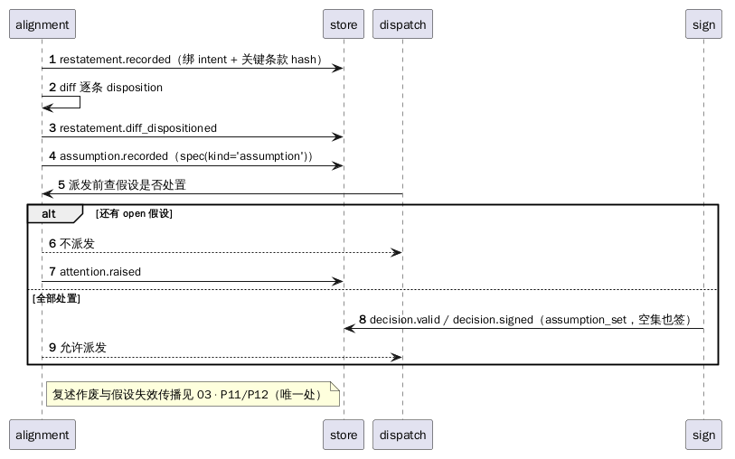

> 图源：`diagrams/uml-seq-align.puml`。复述先绑 intent 与关键条款 hash 再记 diff；假设 `open` 时 `dispatch` 拒绝派发并开 `attention`；全部处置后签 `assumption_set`（空集也要签）才放行。

## 5. 聚合与不变量（一条不变量一个守卫点）

| 不变量 | 唯一守卫点 | 审计（不是守卫） | 类型 |
|---|---|---|---|
| 意图必须有人签 | `Intent.approve` | — | 领域 |
| `strength='inferred'` 不得带高风险条款 | `Intent.approve` | — | 领域 |
| `content_hash` 变 ⇒ 必须重签 | `Intent.approve` | — | 领域 |
| 重签后基线仍有效 | `Intent.reaffirm` | — | 领域 |
| 根必须指向一个 intent（`intent_id` 非空且存在） | `GoalNode.declare` | — | 领域 |
| 每个 intent 至多一个根 | **`goal_node` 的部分唯一索引**（`UNIQUE(intent_id) WHERE kind='intent'`） | — | 表约束 |
| 叶节点必须有验收判据 | `GoalNode.declare` | — | 领域 |
| 父节点验收 = 集成清单全部接上（且至少一条带证据） | `GoalNode.acceptViaIntegration` | — | 领域 |
| 判据必须有 `remedy` | **判据注册器（03 P1）** | verify C 组 | 领域（G3） |
| 判据必须有正例（实跑 pass） | **判据注册器（03 P1）** | verify C 组 | 领域（G3） |
| 判据必须有负例（实跑 fail） | **判据注册器（03 P1）** | verify C 组 | 领域（G3） |
| 判据单次执行 < 200ms | **判据注册器（03 P1）** | —（只测一次，verify 不重跑） | 领域（G3） |
| 同一判据同一极性同一输入不重复 | **`criterion_fixture` 的 `UNIQUE`**（注册器只映射错误码） | — | 表约束 |
| verdict 由读数算出；`na` 不算 pass | `Gate.judge`（03 P2） | — | 领域 |
| stage_run.verdict 不可手填；绑 baseline 与读数 | `StageRun`（由 gate 写） | verify A/C | 领域 |
| 每个 stage 有 `kinds`，判据只在相交的 stage 上适用 | **P15 校验器（03 P15）** | — | 领域 |
| baseline 冻结后内容不可变：收紧/放宽都产生**新行**（新 id、新 hash） | `Baseline.freeze`（03 P15） | verify C | 领域 |
| 放宽类 baseline 变更必须有 `decision(kind='baseline')` 且方向为放宽 | `Baseline.freeze`（03 P15） | — | 领域 |
| policy 的 `kinds`/`after`/`artifact_kinds` 必须在 baseline 内容哈希内 | `Baseline.freeze`（03 P15） | — | 领域 |
| core 判据必须达到有效绑定（适用 stage + `all_of` + 不可豁免） | **P15 校验器（03 P15）** | — | 领域 |
| stage 先后只由 `after` 表达，图无环且全部可达 | **P15 校验器（03 P15）** | — | 领域 |
| `guarantee_delta` 只能由工具按 `guarantee` 元数据算出（手写值忽略） | **P15 校验器（03 P15）** | — | 领域 |
| 一卡一行 | **`work_unit` 的 `UNIQUE(task_id)`** | — | 表约束（G4） |
| 证据与判据一致（判据 `work_unit.evidence_consistent`） | **复合外键 `(evidence_id, criterion_id)`** | — | 表约束 |
| 快照父链完整 | **`snapshot_parent` 的两个外键** | verify B | 表约束（G1） |
| 内容寻址（git_oid 唯一） | `UNIQUE(git_oid)` | verify B | 表约束 |
| `signer ≠ producer` | `Decision.sign`（03 P10） | verify C | 领域 |
| payload / frontier 未变 | `Decision.sign`（03 P10） | — | 领域 |
| `pass` 需全部 finding 已核实 | `ReviewRound.close` | — | 领域 |
| `signer ≠ subject_producer` | `ReviewRound.close` | — | 领域 |
| 只有 unwakeable 才 dead | `Agent` 状态机 | — | 领域 |
| 压缩未完成不可派发 | `dispatch`（读 `watermark`） | — | 领域 |
| 派生列 `code_artifact_sha256` 必须等于重算值 | **L1 `fold` 重算**（G2） | verify C | 领域（G2） |
| `busy` 卡必须有未过期 `lease`，且 `lease.actor = claim.actor` | `dispatch`（发 lease 时绑） | verify D | 领域 |
| 复述必须绑当前 intent（hash 一致，改过即作废） | `restatement` 生成（03 P11） | — | 领域 |
| 条款集合覆盖全部 `requirement`（`spec_set`） | `Decision.sign`（03 P10） | — | 领域 |
| 假设集合覆盖全部 `open` 假设，空集也必须签 | `Decision.sign`（03 P10） | — | 领域 |
| 每条需求条款有 2 正 1 反 | `alignment` 检查（03 P11） | — | 领域 |
| 每条设计条款声明替代方案或"无替代"理由 | `alignment` 检查（03 P12） | — | 领域 |
| `rework_units` 必须等于因变更作废的已完成卡数 | `fold` 复算（03 P13） | verify C | 领域 |
| 未处置的假设不许开工（`spec(kind='assumption')` 无 `open`，且 `rejected` 有后继） | `dispatch`（派发前查） | — | 领域 |
| 已确认的假设随依赖条款变更而失效（回到 `open`，重签 `assumption_set`） | `fold` 传播（03 P12） | verify B | 领域 |
| 假设条款必须有 `status` 与 `blast_radius`（与 `kind` 一致） | **`spec` 的两个 `CHECK`** | — | 表约束 |
| 必须评审的卡要有 `pass` 的 `review_round`（`reviewer ≠ subject_producer`、绑当前 frontier） | `ReviewRound.close`（03 P14） | — | 领域 |
| 冻结范围内门禁全绿或豁免有效 | `Release.freeze`（03 P8） | — | 领域 |
| 冻结时每项 `out` 有 reason + human 署名 | `Release.freeze`（03 P8） | — | 领域 |
| 冻结满足独立性 | `Release.freeze`（03 P8） | — | 领域 |
| 冻结前审计快照已生成 | `Release.freeze`（03 P8） | — | 领域 |
| 冻结前审计快照 `verify` 通过 | `Release.freeze`（03 P8） | verify A–D | 领域 |
| 冻结缺口清单 = 集合差集 | `Release.freeze`（03 P8） | — | 领域 |
| release 声明的 baseline 与每条发布证据的 baseline 相同 | `Release.freeze`（03 P8 前置⑤） | verify C | 领域 |
| 冻结证据在冻结 frontier 内有效 | `Release.freeze`（03 P8） | — | 领域 |
| 冻结前有人执行过 scenario（≥3 条，高风险条款每条款 ≥1） | `Release.freeze`（03 P8） | — | 领域 |
| 弃用窗口未过期或已给替代路径 | `Release.freeze`（03 P8） | — | 领域 |
| 包产物绑 `snapshot_id` 且 sha256 一致 | `Release.deliver`（03 P8） | — | 领域 |
| 回滚必须另开新 release 并写 `release.superseded` | `Release.rollback`（03 P8 末） | — | 领域 |

> 表约束负责“插入就拦”；领域服务负责“语义与资格”。**一行一条不变量、一个守卫点**——同一守卫点可以出现在多行（它守多条），但不允许一行塞多条，也不允许一行写两个守卫点。
>
> **“审计”列不是守卫**：`verify` 只做**事后对账**，它发现漂移时对象已经错了，所以不能算守卫；写在“审计”列是为了让"这条不变量最终会被谁复核"有出处。`UNIQUE` 只兜“同输入重复”这一条，注册器不重复判它、只把冲突映射成错误码。

## 6. G1–G5 的对象级落点（已定 A）

| GAP | 决定 | 影响对象 | 落点 |
|---|---|---|---|
| G1 父链 | 链接表 | `Snapshot` | 新增 `SnapshotParent` 值对象 + 仓储；`Snapshot.take(parents)` 写链接行 |
| G2 派生列 | 应用层重算 | `Spec` | **L1 fold/hash 服务**写列（规范化与重算是领域逻辑，L2 只编排）；`verify` 重算比对 |
| G3 注册门槛 | 唯一入口 | `CriterionRegistry` | 注册器校验：`remedy` + 正例实跑 `pass` + 负例实跑 `fail` + 单次 < 200ms（整组预算在 P2 测） |
| G4 一卡一行 | 表约束 | `Task` / `WorkUnit` | `UNIQUE(task_id)`；多条判据 ⇒ 拆卡 |
| G5 kind 闭包 | 参考表 | `EventStore` | `EventKind` 参考表 + 外键 |

> 方案 B（`FoldService` 校验 / 触发器 / 判据兜底 / 白名单）已**否决**，理由见 [`docs/14`](../docs/14-待决缺口.md)；此处不再保留并列选项。

## 7. 自检

- [ ] 每个聚合有清晰的“一次事务改什么”；
- [ ] 每条不变量在矩阵里有唯一守卫点；
- [ ] 跨聚合只通过事件/端口，不共享可变对象；
- [ ] 值对象全部不可变；
- [ ] 状态图与 `docs/` 的状态枚举一致（无额外状态）；
- [ ] 顺序图覆盖：认领、准入、评审、交付、变更重开、配置冻结、对齐与假设处置（7 条）。
