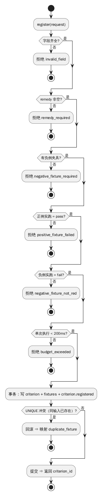
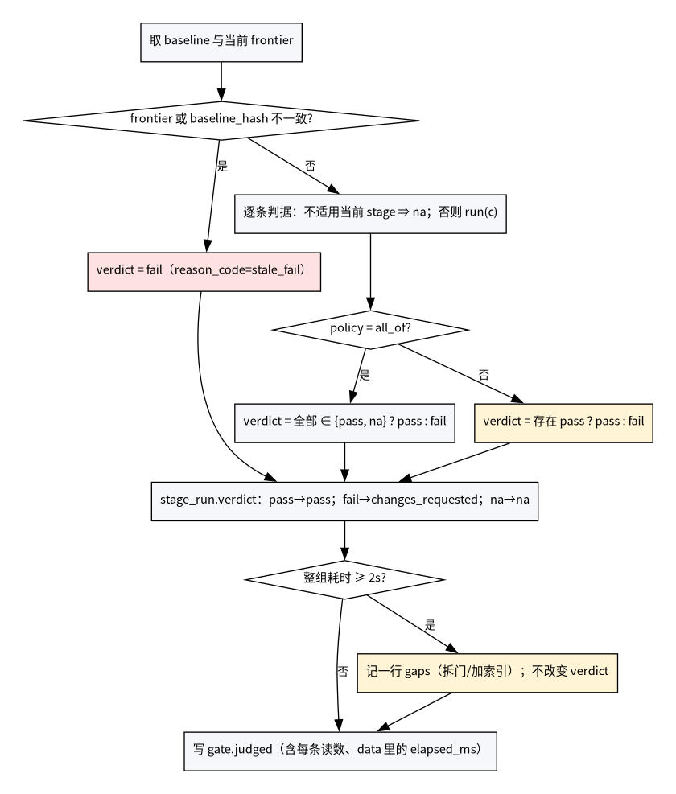
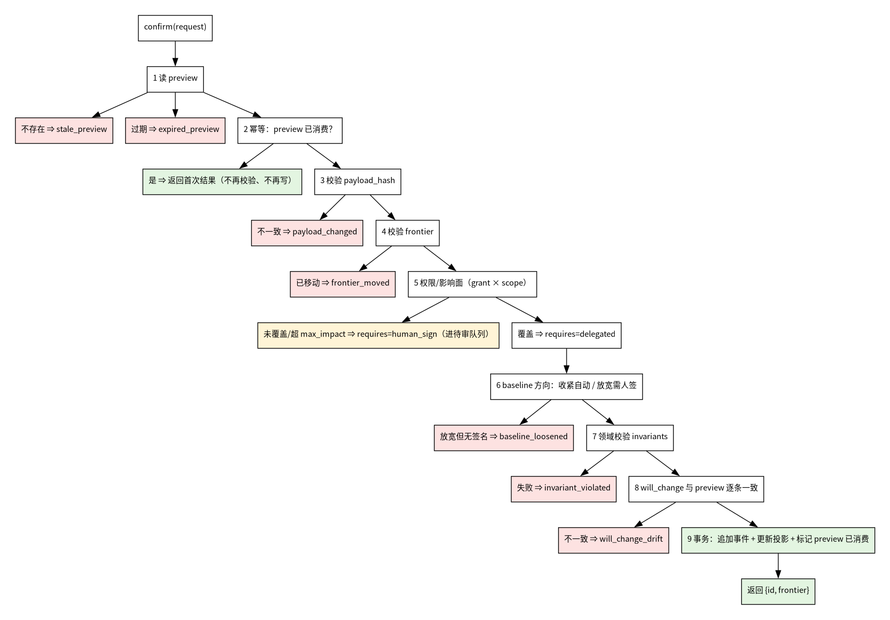
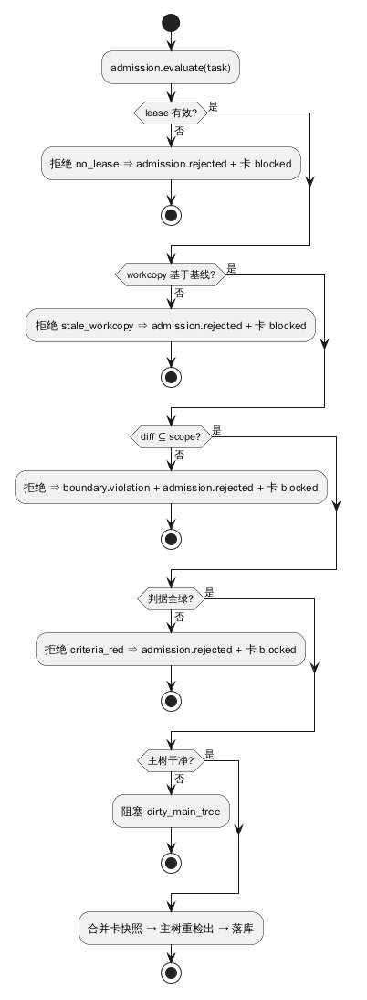
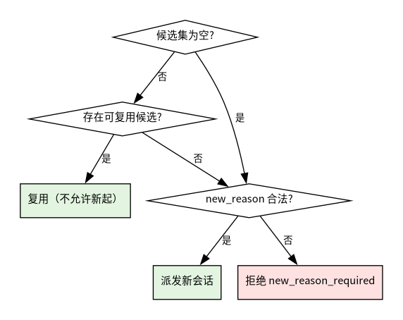
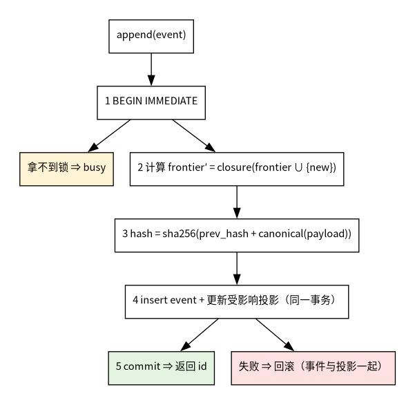
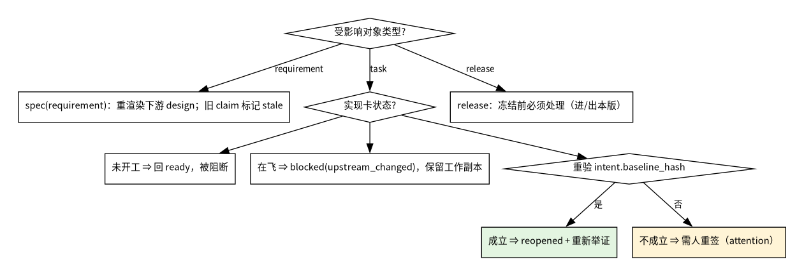
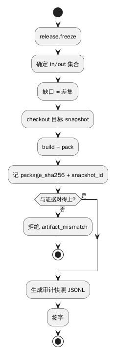
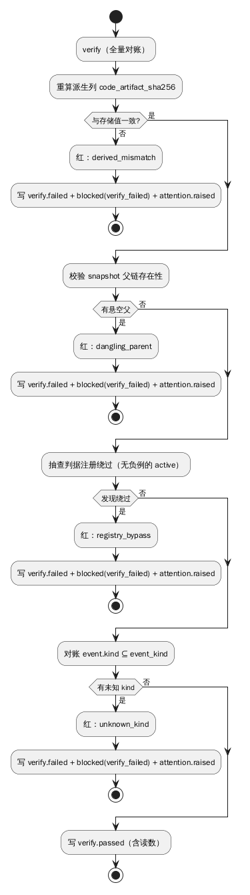
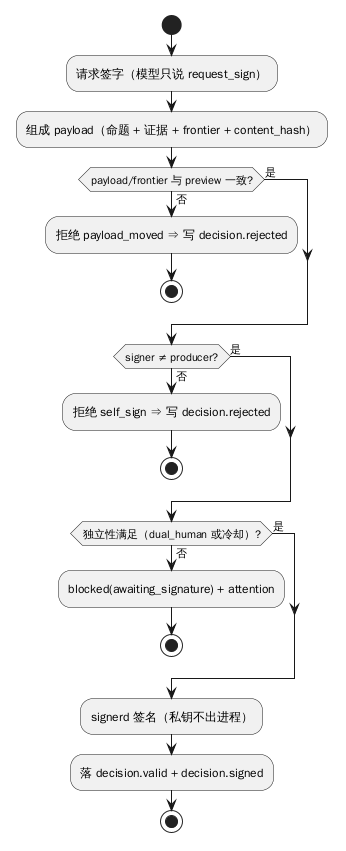

# 过程逻辑：流程图 / N-S 图 / PAD 图 / 判定表

> 本文只放**模块内部的过程逻辑**。它的上游是 [01-结构化设计](01-结构化设计.md)（模块与接口），
> 它的对象是"一个动作从进入到返回，中间怎么走"。
>
> **互斥约定（防两边写矛盾）**：
> 同一段逻辑只允许一种表达方式。对象状态怎么变 → 只写在 [02-面向对象模型](02-面向对象模型.md) 的状态图；
> 对象之间怎么协作 → 只写在 02 的顺序图；**一个动作内部的判断与循环 → 只写在这里**。

## 1. 选图准则

| 要表达的东西 | 用哪种 | 不用哪种 |
|---|---|---|
| 有循环、提前返回、异常分支 | **流程图** | N-S（嵌套会很深） |
| 单入口单出口、纯嵌套结构 | **N-S 图（盒图）** | 流程图（会退化成线团） |
| 强调逐层分解、层次调用 | **PAD 图** | 判定表 |
| 多条件组合决定动作 | **判定表 / 判定树** | 流程图（分支会爆炸） |

一张图对应一个过程；**同一过程出现两张图即为漂移**。

---

## 2. P1 判据注册

对应 `docs/04`「判据注册门槛」、`docs/14` G3。

**流程图**

> 图源：`diagrams/p1-criterion-register.puml`

**判定表**（拒绝原因）

| 字段齐全 | 有 `guarantee` | remedy 非空 | 有负例 | 正例实跑 pass | 负例实跑 fail | 单次 < 200ms | 结果 |
|---|---|---|---|---|---|---|---|
| 否 | — | — | — | — | — | — | `invalid_field` |
| 是 | 否 | — | — | — | — | — | `guarantee_required` |
| 是 | 是 | 否 | — | — | — | — | `remedy_required` |
| 是 | 是 | 是 | 否 | — | — | — | `negative_fixture_required` |
| 是 | 是 | 是 | 是 | 否 | — | — | `positive_fixture_failed` |
| 是 | 是 | 是 | 是 | 是 | 否 | — | `negative_fixture_not_red` |
| 是 | 是 | 是 | 是 | 是 | 是 | 否 | `budget_exceeded` |
| 是 | 是 | 是 | 是 | 是 | 是 | 是 | 注册成功 |

> **两件事刻意不在这张表里**：
>
> 1. **同输入重复**不是注册器的判断——`criterion_fixture` 的 `UNIQUE(criterion_id, polarity, input)` 在插入时直接拒绝，注册器只把这次冲突**映射**成 `duplicate_fixture`（错误码翻译，不是第二次判断）。写在这里会变成两处判同一件事，迟早不一致。
> 2. **整组门禁 < 2s** 注册一条判据时无从知道整组多大，只能在 P2 判完一轮后测（见 §3）。
>
> 另外：这张表只描述**写入路径**的校验。数据库无法表达"至少一正一负"（probe 已证），所以那两个实跑必须发生在注册器里。
>
> **事务边界**：`criterion` 行、它的 `fixture` 行、`criterion.registered` 事件**必须同一事务**提交。否则事件失败会留下一条"`active` 但没注册事件"的判据——`verify` 再也分不清是绕过还是写坏了。

---

## 3. P2 门禁判定

对应 `docs/04`「门禁（gate）」、`docs/01` 命题 2。

**N-S 图（盒图）**

> 图源：`diagrams/p2-gate-ns.dot`

**判定表**（`na` 的地位，`all_of`）

| 有 fail | 有 na | 有 pass | all_of 结果 |
|---|---|---|---|
| 是 | 任意 | 任意 | `fail` |
| 否 | 是 | 任意 | `pass`（**na 不阻断，也不冒充 pass**） |
| 否 | 否 | 是 | `pass` |
| 否 | 否 | 否 | `fail`（空集陷阱，见命题 2） |

`any_of` 是同表的另一侧：**存在 `pass` ⇒ `pass`（`fail` 与 `pass` 并存也放行）；没有任何 `pass` ⇒ `fail`**（全 `fail`/`na` 与空集同罪，理由见 `docs/04` §6）。

**映射**：`stage_run.verdict = pass → pass；fail → changes_requested；na → na`（`docs/03` 的三态）。`frontier` 与读数不符、或**判定用的 baseline ≠ 该 `stage_run` 记录的 `baseline_hash`** ⇒ `verdict = fail`，`reason_code = stale_fail`（**不是**第四种 verdict，仍按 `fail → changes_requested` 映射）。**"存在更新的 baseline"本身不触发 `stale_fail`**——在飞的 `stage_run` 用旧尺判完是合法的（见 §16「换尺子之后谁按哪把」）。

### 3.1 P2 实际执行的判据

门禁判定不只是"算 verdict"：**下面这些判据都在 P2 读到数**（其余判据在写入路径 P1/P4/P6 或表约束里执行）：

- **阶段产出**：`stage.requirement_complete`、`stage.design_traceable`、`design.covers_spec`、`design.no_spec_creep`；
- **对齐**：`intent.restated_consistent`、`alignment.examples_present`、`design.alternatives_declared`、`assumption.disposed`、`assumption_set.signed`；
- **授权**：`intent.explicit_for_risk`、`spec_set.signed`、`mandate.revalidated`、`scope.present`；
- **结构**：`node.acceptance_bound`、`node.integration_listed`；
- **收口**：`task.complete`、`review.required`、`review.round_bound`、`design.code_matches`、`change.rework_counted`；
- **凭证**：`provenance.present`、`redteam.disposed`、`stage.gate_bound`。

> `work_unit.evidence_consistent` 不在 P2：它是**复合外键**，插入时就拦（表约束），P2 只读结果。这就是"执行点"与"阶段归属"的区别。

**预算**：一轮判完测整组耗时，`data` 里的 `elapsed_ms` 落进 `gate.judged`；≥ 2s ⇒ 记一行 `gaps`（修法：拆门/加索引），**不改变 verdict**。单次 < 200ms 已在注册时卡过（§2）。

---

## 4. P3 两段式写（confirm）

对应 `docs/11`「两段式写协议」。

**preview 是谁生成的**（这一步以前只在 P3 里被"读"，没有生成过程）：`handlers.preview(action, payload)` 读对象当前值 → 逐字段算 `will_change` → 算 `rework_units`（因变更作废的已完成卡数）→ 规范化 `payload_hash` → 落 `preview` 行。**它不改世界**，所以不是"写"；单步动作走 `handlers.append`（白名单见 `docs/11` §8），不进这条链。

**PAD 图**

> 图源：`diagrams/p3-two-phase-pad.dot`
>
> **一条链，没有旁路**（顺序即执行顺序）：
>
> 1. **读 preview**——不存在 ⇒ `stale_preview`；过期 ⇒ `expired_preview`；
> 2. **幂等**——`preview_id` 已被消费 ⇒ **直接返回首次结果**，不再验、不再写（必须在任何校验之前，否则二次 confirm 会先重提交再返回）；
> 3. **payload hash**——不一致 ⇒ `payload_changed`；
> 4. **frontier**——已移动 ⇒ `frontier_moved`；
> 5. **权限/影响面**（grant × scope）——先查 5.1 本 preview 是否已有有效签字（按 `payload_hash + frontier` 匹配 `decision(status='valid')`）：有 ⇒ 视为已授权、直接放行；没有 ⇒ 未覆盖或超 `max_impact` 则 `requires=human_sign`，覆盖则 `requires=delegated`；
> 6. **baseline 方向**——收紧自动、放宽需签，否则 `baseline_loosened`；
> 7. **领域不变量**——失败 ⇒ `invariant_violated`；
> 8. **`will_change` 与 preview 逐条一致**——不一致 ⇒ `will_change_drift`（在事务**之前**比对，改动不了就还没提交）；
> 9. **事务**：追加事件 + 更新投影 + 标记 preview 已消费；返回 `{id, frontier}`。
>
> 四道校验（3–6）的顺序与 `docs/11` §9 的四行一一对应，且**串联**：任何一道红即返回。图上不存在 `2→3`、`3→4`、`3→5`、`4→6` 这类跳过某一环的边。

**`human_sign` 不是终点，是"挂起"**（人签路径的最后一公里）：

1. 返回 `pending_sign(preview_id)`，**不消费 preview**（也**不写业务事件**：世界没变，只是等人）；
2. 人签走 P10，落 `decision.valid` + `decision.signed`。**签的是 `(payload_hash, frontier)` 这对值**，不是 `preview_id`——`decision` 表里没有 `preview_id` 列（`docs/06` §7），而 preview 行里存的正是这两个值，所以能反查；
3. 模型**用同一个 `preview_id` 再 confirm 一次**：第 5 步先查 **5.1 本 preview 是否已有有效签字**——按 `(payload_hash, frontier)` 找 `decision(status='valid')`：
   - **有** ⇒ 视为已授权，跳过 grant/scope 的拦截，继续 6–9；
   - **没有** ⇒ 才判覆盖：`delegated` 继续；`human_sign` 再返回 `pending_sign`；
4. 这一步是**必须有**的：否则第二次 confirm 会再次命中 `human_sign`，人可以签无数次而状态机永远不前进；
5. 回到第 2 步幂等检查——preview 未被消费 ⇒ 继续；期间重新校验 payload/frontier，若世界已变 ⇒ `payload_changed`/`frontier_moved`，**要求重新 preview**，不许拿旧签字硬套新世界；
6. 事务提交时才标记 preview 已消费；第二次 confirm 因此不会重复提交。

`requires=delegated` 则不同：进待审计队列的同时**可以继续**（这是授权范围内的自决），审计是事后追认。

---

## 5. P4 准入

对应 `docs/07`「准入」、`docs/03` 快照/工作副本。

**流程图**

> 图源：`diagrams/p4-admission.puml`

**判定表**

| lease | workcopy 基于基线 | diff ⊆ scope | 判据绿 | 主树净 | 结果 |
|---|---|---|---|---|---|
| 否 | — | — | — | — | 拒绝 `no_lease` |
| 是 | 否 | — | — | — | 拒绝 `stale_workcopy` |
| 是 | 是 | 否 | — | — | 拒绝 + `boundary.violation` |
| 是 | 是 | 是 | 否 | — | 拒绝 `criteria_red` |
| 是 | 是 | 是 | 是 | 否 | 阻塞 `dirty_main_tree` |
| 是 | 是 | 是 | 是 | 是 | 准入 |

**事件落点**（对应 `docs/07` §19.5）：

- 前四行**改变卡的状态** ⇒ 落 **`admission.rejected(reason_code)`** + `task.blocked(reason_code)`——"卡为什么停在这里"必须有真源；`diff ⊄ scope` 那一行**另加** `boundary.violation`（两者不是二选一）；
- 最后一行 `dirty_main_tree` **不落 `admission.rejected`**：主树脏是环境问题、不是这张卡的违规，写一条 `blocked(dirty_main_tree)` 回执并进 `attention` 让人清树即可。

---

## 6. P5 派发与复用

对应 `docs/12`「派发：唯一入口，复用是默认」。

**前置：候选筛选**（`docs/12` 硬条件）：存活 / `state='idle'` / `rights × scope ⊇ 卡` / `watermark < 限值` / 评审卡还要求 `actor ≠ producer(subject)`；**卡关联的 `assumption` 必须全部处置完**（`assumption.disposed`，`open` 存在 ⇒ 不派发）。**筛完才有候选集**，下表从候选集开始。

**判定表**

| 有候选 | 候选可复用 | `new_reason` 合法 | 结果 |
|---|---|---|---|
| 否 | — | 必须是三选一之一 | 新起；否则拒绝 |
| 是 | 是 | — | **强制复用**（拒绝新起） |
| 是 | 否 | 必须是三选一之一 | 新起；否则 `new_reason_required` |

**判定树**

> 图源：`diagrams/p5-dispatch-tree.dot`

---

## 7. P6 事件追加与投影

对应 `docs/02`「事件/折叠/单写」。

**PAD 图**

> 图源：`diagrams/p6-append-pad.dot`

---

## 8. P7 变更与重开

对应 `docs/11`「影响链/复位表」、`docs/03` `task.reopened`。

**判定树**

> 图源：`diagrams/p7-change-tree.dot`

---

## 9. P8 交付打包

对应 `docs/09`「交付物」。

**流程图**

> 图源：`diagrams/p8-release.puml`

**顺序与事件落点**（与图一一对应）：

1. 确定 in/out 集合；缺口 = 差集（`release.gaps_match`，多/少均红）；
2. **冻结前置五条**（`docs/09` §3，任一不过 ⇒ 拒绝 `freeze_blocked(reason_code)`，**不落 `release.frozen`**）：
   ① 范围内门禁全绿（或豁免带有效期与签字）；② `out` 每项有 `reason` + human `approved_by`（`release.out_signed`）；③ 独立性满足（`release.independence_satisfied`）；④ 缺口 = 差集（`release.gaps_match`）；⑤ **本版只按一把尺子判**：`release` 行的 `baseline_hash` 非空，且 `in` 集合每条发布证据的 `baseline_hash` 都等于它（不等 ⇒ `baseline_mixed`）；旧尺下通过的卡要进这版，必须先在新尺下重判；
3. **两条 release 判据也必须在冻结前判**：发布证据在冻结 frontier 内有效（`release.evidence_valid`）、弃用窗口未过期或已给替代路径（`release.deprecation_window`）。**7 条 release 判据一律在冻结时点现算**，用的是 `release` 声明的 `baseline_hash`——不复用别处（可能是旧尺子下）的判定读数；
4. **人执行 scenario 抽样**（`docs/09` §3 第 6 条）：每个 release 至少 3 条、`risk_flags` 非空的条款**每条款至少 1 条**，`ran_by` 必须是 human（模型跑的不算）；不足 ⇒ 拒绝 `scenario_not_run`。跑过的清单进签字 payload 的 `scenarios_run[]`——**这是"产品对不对"的唯一外部锚**，不依赖模型自证；
5. 生成审计快照 JSONL（`frozen_at_frontier`）——`docs/09` §3 的"④ 审计快照"**必须排在这里之后**：快照 `verify` 不过 ⇒ 拒绝 `release.snapshot_verified`（快照存在 ≠ 快照可信）；
6. **签字落 `decision.valid` + `decision.signed`**——`valid` 是"校验通过"，`signed` 是"密码学签字"；`release.frozen` 声称"含签字"，靠的就是这两条，缺 `decision.signed` 的冻结不算签过；
7. **写 `release.frozen`**——`status='frozen'` 的唯一生产者；
8. `checkout(snapshot_id)` → `build` → `pack`，记 `package_sha256` + `snapshot_id`；
9. 产物与证据对不上 ⇒ 拒绝 `artifact_mismatch`（**不落 `release.delivered`**，release 停在 frozen）；
10. 对得上 ⇒ **写 `release.delivered`**——`status='delivered'` 的唯一生产者。

> **与 `docs/09` §3 的清单不是同一集合**：那里的七项在本文**都有落点**，但"前置五条"只覆盖其中的门禁/out/独立性/缺口/baseline 五项；**scenario 与快照是本文的步骤 4/5，不在前置里**（它们在签字之前、前置之后）。别把"§3 七项"读成"前置七条"。

**7 条 release 判据的落点**（`docs/09` §12，一条不漏）：

| 判据 | 在哪判 |
|---|---|
| `release.gaps_match` | 步骤 1 / 前置④ |
| `release.out_signed` | 前置② |
| `release.independence_satisfied` | 前置③ |
| `release.evidence_valid` | 步骤 3 |
| `release.deprecation_window` | 步骤 3 |
| `release.snapshot_verified` | 步骤 5 |
| `release.artifact_sha256` | 步骤 8–9（打包时算、产出后比对） |

"先冻结、后打包"是合法的；反过来不成立，因为 `delivered` 必须绑一个已冻结的 `snapshot_id`。

**回滚**（不在本流程内）：`decision(kind=rollback)` → 写 `release.superseded`（绑新 release id）→ 另开新 release；原行不改状态以外的东西。

---

## 10. P9 全量对账（verify）

对应 `docs/14` 的兜底与 `docs/02`「verify」。

> 图源：`diagrams/p9-verify.puml`（由 `build.py` 生成，改模板不要改产物）

**范围 = `docs/02` §14 的十项 + `docs/14` 的两条兜底 + kind 闭包**，按失败后果分四组（条目定义在 `docs/02`，这里只加分组与失败码）：

| 组 | 查什么（← `docs/02` §14 对应项） | 失败码 |
|---|---|---|
| **A 事件链** | hash 链连续、`prev` 存在、`state.cursor` 与事件数一致 | `chain_broken` |
| **B 引用** | `subject` 外键可解析、`claim.derived_by` 已注册、`snapshot_parent` 无悬空（`docs/14` G1）、`event.kind ⊆ event_kind`（G5） | `reference_dangling` |
| **C 判定** | 派生列 = 重算值（G2）、每条 `active` 判据**有 `remedy` + 正例 + 负例**（不是"无负例"）、判定引用的 `baseline` 仍已冻结且可复算、**`direction` 与内容 diff 一致**（收紧/放宽不能记反）、**每条 `assumption.disposed` 的 `decision_id` 指向有效 `assumption_set`**（该 decision 的 `spec_ids[]`/`dispositions[]` 覆盖这条且一致，状态与事件一致）、**每条有效 `assumption_set` 的 `dispositions[]` 都有对应的 `assumption.disposed`**（缺 ⇒ 按 `decision_id` 幂等重放，重放后仍缺 ⇒ 红）、`decision.signature` 可验且 `signer ≠ producer`、**release 冻结（`kind='freeze'`）的 `scenarios_run[]` 非空且 `ran_by` 是人**（`kind='baseline'` 不要求） | `judgement_mismatch` |
| **D 运行态** | `busy` 卡有未过期 `lease` 且 `lease.actor = claim.actor`、库加密状态与 `assurance.db_confidentiality` 一致 | `runtime_inconsistent` |

> C 组的判据检查按 `docs/04` 注册门槛的前三条走：**`remedy`、正例、负例都查**。只查"无负例"会漏掉"有负例、没正例"和"有正负例、没 remedy"两种绕过——它们都是绕过写入路径直接插库能造出来的。
>
> **单次 200ms 预算不在 verify 里重测**：那要重跑判据，而 `verify` 是**对账**不是**执行**；预算只在注册时测一次（`03` P1），`verify` 只核对"注册时确实测过"的痕迹（`gate.judged`/`criterion.registered` 里的读数）。

- 全绿 ⇒ 写 `verify.passed`（含四组读数）；
- 任一组红 ⇒ 写 **`verify.failed`**（`reason_code` + 读数），把受影响对象 `blocked(verify_failed)`，`attention.raised`；
- `verify` **不改数据、不自动修复**：修复由人决定（改数据 / 从备份恢复），这是注意力预算里"失败不可恢复"那一类。

## 11. P10 签字

对应 `docs/06`「签字只签决策」。**每个 `decision` 都必须人签**——签名是"模型不能代签"的物理保证，不能省。

**要压的是人工时间，不是签字本身**：认证走 passkey/平台认证器（生物识别或设备 PIN，不记长口令）；免密窗口内可连签；签字页只显示"签什么 + 影响几条"。成本目标 **≤ 10 秒、≤ 2 次交互**（首次解锁除外）。红线三条：不可省、不可代签、不可"全部同意"盲签。

> 图源：`diagrams/p10-sign.puml`（由 `build.py` 生成）

**顺序**：组 payload（命题 + 证据 + frontier + content_hash）→ 校验 payload/frontier 未变 → `signer ≠ producer` → 独立性（`dual_human` 或冷却）→ `signerd` 签名 → 落 `decision.valid` + `decision.signed`。模型只发 `request_sign`，不接触私钥。

**集合签字（`spec_set` / `assumption_set`）**：`spec_ids[]` 由**工具**按当前开放集合算，不是模型填——需求集合 = 全部 `requirement` 条款，假设集合 = 全部 `open` 假设（为空则签空集）。模型只能"请求签这个集合"，改不了集合内容；这样"少签一条"不可能由模型造成，只能由工具 bug 造成，而那是 `verify` 的事。

**事件落点**（对应 `docs/06` §2.1）：

| 分支 | 落什么 | 为什么 |
|---|---|---|
| `payload_moved` / `self_sign` | **`decision.rejected(reason_code)`** | 这次签字请求被拒，`decision` 的 `status='invalid'`——请求方要知道"被拒了、为什么"，只回 code 不落事件就查不到 |
| 独立性不满足 | **不写 `decision.rejected`**，写 `blocked(awaiting_signature)` + `attention.raised` | 不是拒绝，是**还没签**；请求仍在排队，人补签后继续 |
| 签名成功 | `decision.valid` + `decision.signed` | `valid` = 校验通过；`signed` = 密码学签字（`docs/02` 定义） |

## 12. P11 对齐与复述

对应 `docs/13` §2.1（对齐检查点）、`docs/04` `intent.restated_consistent` / `alignment.examples_present`。

**判定表**

| 情形 | 结果 |
|---|---|
| `restatement.inputs` 的 intent hash ≠ 当前 intent 的 `content_hash` | **旧复述作废**（`restatement.invalidated`），必须重跑——需求改过、复述没跟上，等于没对齐 |
| **关键 requirement 条款**（`risk_flags` 非空或 `is_core=1`）的 hash 不在复述 `inputs` 里，或已变 | 同样作废：只绑 intent 不够，"条款改了但 intent 没改"正是需求随实现变化的常见形态 |
| 复述晚于它要复述的条款（复述的 `at` ≥ 最早一条 `spec` 的 `at`） | 作废并重跑：复述必须**在第一条 `spec` 之前**落地（`intent.restated_consistent` 要求复述的 `at` 早于最小 `spec` 的 `at`）；"先写条款再补复述"等于没对齐 |
| 复述 diff 有未处置行或 `defer` | 不许进设计阶段 |
| 条款没有 2 正 1 反 | `alignment.examples_present` 红；**trivial 条款可判 `na`**（须写 `reason='trivial'`，且 `risk_flags` 非空的条款**不许**用 trivial 豁免） |
| 全过 | 允许进设计 |

**复述对的是原话，不是摘要**：`intent.source_text` 是用户原话（可脱敏），`statement` 是模型摘要；diff 对 `source_text` 做。否则"记录是否忠实于我说的话"无法核对——签的只是模型的摘要。

## 13. P12 假设处置

对应 `docs/03`「`kind='assumption'`」、`docs/04` `assumption.disposed` / `assumption_set.signed` / `design.alternatives_declared`。

**判定表**

| 情形 | 动作 |
|---|---|
| 设计条款有 ≥2 个可行方案 | 必须链一条 `assumption`（选哪个/排除哪个/错了怎么办）或开 `attention` |
| 设计条款既没 `alternatives[]` 也没 `no_alternative_reason` | `design.alternatives_declared` 红——"没有替代方案"必须写出来，不能默认 |
| `no_alternative_reason` 是**自述** | 对 `risk_flags` 非空的设计条款**必须**派红队复核（"真的没有第二个可行方案？"）；其余抽样复核——判据只保证"写了"，不保证"是真的" |
| 新建卡 | **必须继承其 `intent` 下所有已确认的假设**（写进 `task.inputs[]`），否则 `assumption.disposed` 会漏查历史假设 |
| 没覆盖的选择**不可逆**（删数据、迁移、发布、对外契约） | 开 `attention`（阻塞），不许记假设 |
| 没覆盖的选择**可回退** | 落 `spec(kind='assumption')`（`assumption.recorded`），必须带 `blast_radius`；同时写进受影响卡的 `task.inputs[]` |
| 处置一批假设（**唯一授权入口**） | ① 人看当前 `open` 集合，逐条选 `confirmed` / `rejected`（带后继）/ `converted`（带新条款 id）；② 工具渲染 `spec_ids[]`（**这一批被审的假设**，即 preview 时的 `open` 集合）与 `dispositions[]`（人选的结果）；③ 人签 `decision(kind='assumption_set')`；④ 签完，工具按载荷**逐条写 `assumption.disposed(decision_id=…)`** |
| 处置事件本身 | `assumption.disposed` **必须带 `decision_id`**（指向覆盖该条的集合签字）与 `disposition`；**没有有效签字的处置一律拒**——模型不能自己写一条 `rejected` 就把假设从 open 里拿掉。`rejected`/`converted` 必须带 `successor_ref`（分别指向 `spec.revised`/`change.applied` 或升级成的新条款） |
| 它依赖的条款变了（`inputs[]` 命中） | 落 `assumption.invalidated` ⇒ 回到 `open`；受影响卡的 `task.inputs[]` 重算，**必须重新签一批**（旧签字的覆盖不算数） |
| 失效怎么被**检测**出来 | `fold` 规则（算法在 `docs/03`）：`inputs[]` 每条边记 `{kind,id,hash}`；**任何让 input hash 变化的事件**后比对，任一不等 ⇒ 落一条 `assumption.invalidated`（按 `(spec_id,input_id,旧hash)` 幂等），回 `open` 后按新 hash 重建边 |
| 假设 `open`，或 `rejected` 但没有后继 | **不派发、不开工**（`assumption.disposed` 的 fail 分支） |
| 什么时候算处置完 | 三条同时成立：①**不存在 `open` 的假设**（`invalidated` 回 `open` 即算未处置，旧签字不算覆盖）；②每条非 `open` 的状态都由带有效 `decision_id` 的 `assumption.disposed` 投影；③存在有效集合签字（**空集也要签**：签空集 = 我确认这一批没有假设） |

## 14. P13 变更与返工面

对应 `docs/11` §7.5/§7.6、`docs/04` `change.rework_counted`。

**判定表**

| 情形 | 结果 |
|---|---|
| 一句话变更 → spec diff → 影响集 + `rework_units` → apply/defer/reject | 默认模式的完整闭环；**不签字、不评审** |
| `change.applied` 缺 `rework_units`，或与"作废的已完成 `work_unit` 数"复算不一致 | `change.rework_counted` 红 |
| 变更原因未分类 | 必须给 `reason_kind`（`misread`/`late_requirement`/`acceptance_missing`/`context_lost`），否则返工账分不清好坏 |
| 变更后旧复述/旧假设仍被当成有效 | 分别按 P11（复述作废）与 P12（假设失效，`assumption.invalidated`）处理 |

## 15. P14 评审收口

对应 `docs/04` `review.required` / `review.round_bound`、`docs/13` §7「哪些卡必须评审」。

**判定表**

| 卡的情形 | 结果 |
|---|---|
| `risk_flags` 非空 / 实现 `spec(kind∈{design,contract})` / **与 `release` 相关** | **必须有** `review_round`：`verdict='pass'`、`reviewer ≠ subject_producer`、绑**评审时点**的 `baseline_hash`/`frontier`（存进 round；收口时不与检查时点的当前 baseline 重比，否则每次换尺子都要全量重审） |
| "与 `release` 相关"怎么算 | 数据来源：该卡的 `spec` 被任一 `release` 的 `release_item(disposition='in')` 覆盖，**或**卡属于某个已冻结 `release` 的 `frontier` 范围内；不是按名字猜 |
| 有 `review_round` 但 `reviewer = subject_producer` | 红——这是自评，不是评审 |
| 有 `review_round` 但 `frontier` ≠ **被评对象的当前版本 frontier** | 红——评的是旧版本。注意这里比的是**被评对象**，不是仓库全局 frontier，否则评审之后任何一条新事件都会让结论失效 |
| **抽样命中**（policy 的 `review` 参数：`sample_every`/`sample_seed`） | 按**单调卡序号** `seq` 取模（`(seq - sample_seed) mod N == 0`）：任意连续 N 张里恰好 1 张命中，**hash 不参与判定**（hash 取模只保证期望覆盖，可能连续不中）；命中即**必须有** `review_round`——**低风险也不例外**；否则"低风险"由作者自评就能绕开评审。抽样结果落 `gaps` 一行，与 `review.required` 读数一起报告；`sample_every`/`sample_seed` 在 baseline 里，改它等于换尺子 |
| 低风险卡（`risk_flags` 空 + 无契约 + 非 release） | 可以只走 `task.complete`；"低风险"由数据推出，不许模型自评 |
| 收口 | `task.complete` 对该类卡追加 `review.required` 绿；评审结论由裁定者落 `review_round(verdict)` |

**solo 的边界**：`reviewer ≠ subject_producer` 在单人下只能保证"不是同一个会话"，不保证"不是同一个模型/偏见"（`docs/07` §7）。所以 P14 的门是**必要不充分**——它挡住"自己评自己"，挡不住"同一个脑子换个会话"。

## 16. P15 配置与冻结（baseline）

对应 `docs/04` §5（baseline）、`docs/08` §1（policy）、`docs/06` §5（签字）。

**它解决的是"实现时各自发挥"**：配置不是写在文档里让人猜，而是一条有校验、有预览、有签字的流程。

**判定表**

| 步骤 | 做什么 | 不过怎么办 |
|---|---|---|
| 1 选型 | 选 preset（`waterfall`/`prototype`/`incremental`）或写自定义 policy | — |
| 2 校验 | ① 每个 stage 有 `id` 与**非空 `kinds[]`**，`kinds ⊆ {requirement, design, implement, review, deliver}`，`id` 唯一（`stage_bad_kind`）；② **每条 `after` 边指向存在的 stage，图无环，且所有 stage 从入口可达**（`stage_bad_after`；**入口 = `after` 为空的 stage 集合**，允许多个根）——数组顺序不承载语义；③ `gates{}` 的键都是存在的 stage（`stage_unknown`）；④ 每个 stage **至少绑一个 gate**（`stage_no_gate`）；⑤ **每个 gate 至少一条判据**（空 `criteria[]` ⇒ `gate_empty`）；⑥ gate 的每条判据都已注册（`criterion_unregistered`）；⑦ **先按判据的 `保证` 元数据机械算出 `guarantee_delta`**（`docs/04` §4：某条保证下只要有判据没达到 §6 的**有效绑定**（已注册、在 gate 的 `criteria[]` 里、stage 适用、`policy_mode='all_of'`、`waivable=false`），该保证就降级），**再**校验：core 判据（`spec_set.signed`/`assumption_set.signed`/`provenance.present`）必须在**每一个适用的 stage 出口**都达到 §6 的**有效绑定**，否则 `core_not_effective`——**绑在 `na` 阶段、放进 `any_of` 门、放进可豁免的 gate、只在某一个 stage 绑过，四种都算没查**（检查点不连续，就能在中间放一条未处置的假设过去）；**没有「写降级就放行」的分支**——core 缺 kind 就是 `core_not_effective`，lite 必须留着绑 core 的那个 kind；delta **由工具算，手写值一律忽略**；⑧ `artifact_kinds` 的**枚举键**覆盖 `prototype/product/throwaway`；⑨ `assurance.na_stages[]` 由 `stages[]` 里的 `kinds` × `applies_to` 推出、不许手填（元素是 **kind**，不是 stage id）；⑩ `engine` 版本与 `criteria_manifest_hash` 必填；⑪ **`review` 参数合法**：`sample_every` 必须是整数且 `≥ 2`（**不允许 `0`/关闭**——`guarantee_delta` 只按判据绑定推导，表达不了「关掉抽样」这种降级；真不想抽就设一个很大的 N，它会被写进 baseline 让人看见），`sample_seed` 必填整数 | 任一不过 ⇒ **拒绝冻结**，落 `baseline.rejected(reason_code)`（要能查"为什么冻不了"），不许"先生效后补" |
| 3 组 baseline | **`prev` + `direction`** + `engine{version, criteria_manifest_hash}` + `policy{stages[{id, kinds[], after[]}], gates{}, switches, regression, review{sample_every, sample_seed}, artifact_kinds}` + `criteria[{id,version,params, guarantee}]` + `gates[{id,stage,criteria[],policy_mode,waivable}]` + `thresholds` + `assurance` | 漏 `engine` ⇒ 升级就绕过冻结；漏 `kinds`/`after` ⇒ `na` 与先后都算不出来；漏 `direction` ⇒ 可以把 loosening 记成 tighten（`verify` 会按内容 diff 复算） |
| 4 预览影响（两段式 preview） | 返回 **`will_change`**（相对上一版：哪些 gate 增删、哪些判据从 applicable 变 `na`、收紧/放松各几项；**首次冻结写"首次"，没有"上一版"可比**）、第 2 步已算好的 **`guarantee_delta`**（绝对判定，不是相对值），以及 `payload_hash`。confirm 绑 `payload_hash` 才继续——与 P3 同一条链 | 人没看或没 confirm ⇒ 不许签；校验不过 ⇒ `baseline.rejected` |
| 5 人签 | **`decision(kind='baseline')`**（不是 `freeze`——那是 release 冻结，必带 `scenarios_run`）+ 密码学签名；payload 带 baseline 的 `id/hash/policy_id` + **`will_change_hash`** + **`guarantee_delta`**（命题由工具渲染，`docs/06` §5）；落 **`baseline.frozen`** | 无签名 ⇒ 不生效；缺 `guarantee_delta` ⇒ 不可签发（否则是盲签） |
| 6 运行期 | 只读：`stage_run` 记 stage id 与 `baseline_hash`；卡从 `stage_run` 反查 policy，**按 stage id 取 `kinds` 判适用性**（库里不存第二份 kind，否则 stage 语义能绕开 baseline 改） | 缺 `baseline_hash` 的判定无效 |

**变更怎么落**（这一步以前只写了规则、没写事件，是"登记了却没人写"的空档）：
- **收紧**（加判据/升阈值/加 gate/删 stage 的 `na` 豁免）⇒ 落 **`baseline.amended`**：**新建一行** baseline（新 id + 新 hash，`prev` 指向旧行，`direction='tighten'`），可即时生效、事后追认；
- **放宽**（降阈值/删判据/解绑 gate/`artifact_kinds` 放行/去掉某 stage 的 kind）⇒ 必须**先有** `decision(kind='baseline')`，再落 **`baseline.loosened`**（同样是新行，`direction='loosen'`）；
- **绝不原地改 hash**：判定记录只对它引用的那版负责（`docs/04` §5.2），原地改会让历史判定全部对不上账——这正是"换尺子后历史全红"那个坑。

**变更**：走 `docs/04` §5.2 的方向不对称——收紧可即时（事后追认），**放宽必须事前人签**，且必须写"这会放行什么"。改 `artifact_kinds`（例如把 `prototype` 改成 `releaseable`）**视同放宽**，必须走这一步，否则等于绕过"原型转正必须签字"（`docs/08` §2）。**改 `stages[]` 里的 `kinds` 同样是放宽**：把某个 stage 的 `requirement` 拿掉，等于把 `spec_set.signed` 变成 `na`——必须事前签，而且在 `guarantee_delta` 里写明保证 1 降级。

**换尺子之后谁按哪把**（与 `docs/04` §5.2 第 5 条一致）：
- 判定记录只对**它引用的那版** baseline 负责，`verify` 不与"当前 baseline"比；
- **在飞的 `stage_run` 用旧 baseline 判完**，不强制重判；
- **release 必须声明 `baseline_hash`**，证据只能来自同一版；旧 baseline 下通过的卡要进新版本 ⇒ 必须重判。

**校验器**（实现时是一个校验函数，不是新判据）：上面第 2 步的十条（①–⑩），全部在冻结前返回可读错误码；运行期不再重复检查（那是 `verify` 的事）。

## 17. 与文档的对应

| 过程 | `docs/` 来源 | 对应判据 | 模块（R30 校验） |
|---|---|---|---|
| P1 判据注册 | `04` 注册门槛 | `provenance.present`（间接） | `criteria` |
| P2 门禁判定 | `04` 门禁、`01` 命题 2 | `stage.gate_bound` | `gate` |
| P3 两段式写 | `11` 协议 | 四个校验 | `handlers` |
| P4 准入 | `07`、`03` | **间接**：准入不是 24 条之一，它是写入路径的强制门；它读 `scope.present`（范围）与 `stage.gate_bound`（复跑读数）作为输入 | `admission` |
| P5 派发 | `12` | — | `dispatch` |
| P6 事件追加 | `02` | — | `store` |
| P7 变更重开 | `11`、`03` | `mandate.revalidated` | `workflow` |
| P8 交付 | `09` | `design.code_matches` | `release` |
| P9 全量对账 | `02`、`14` | `verify` 自身（派生列/父链/注册/kind），不是 24 条之一 | `verify` |
| P10 签字 | `06` | 独立性与 `signer ≠ producer` | `sign` |
| P11 对齐与复述 | `13` §2.1、`03` restatement | `intent.restated_consistent`、`alignment.examples_present` | `alignment` |
| P12 假设处置 | `03` assumption、`06` §5.1 | `assumption.disposed`、`assumption_set.signed`、`design.alternatives_declared` | `alignment` |
| P13 变更与返工 | `11` §7.5/§7.6 | `change.rework_counted` | `workflow / fold` |
| P14 评审收口 | `13` §7、`07` §7 | `review.required`、`review.round_bound` | `review` |
| P15 配置与冻结 | `04` §5、`08` §1、`06` §5 | `stage.gate_bound`（运行期）；配置期由校验器守 | `gate` |

### 17.1 24 条阶段判据的落点（一条不少）

> **列的含义改了**：第二列是**执行点**（谁产生读数），第三列是**数据来源**（读数里的字段从哪来）。以前把"数据来源"写成"落点"，于是出现"`provenance.present → P1`"这种错位——P1 是判据注册，不写 `task`/`spec` 的 `created_by`。
>
> **执行点只有两种**：`P2`（门禁判定读全部 gate 类判据，见 §3.1）与 `02 矩阵`（表约束类，插入即拦，P2 只读结果）。这张表因此可以机器核对：每个 code 必须出现在它声称的执行点正文里（R28）。

| 判据 | 执行点 | 数据来源（由谁写） |
|---|---|---|
| `stage.requirement_complete` / `stage.design_traceable` / `design.covers_spec` / `design.no_spec_creep` | P2 | 需求/设计出口的 gate；`design/01` 模块表的 consumer 检查 |
| `design.alternatives_declared` / `assumption.disposed` / `assumption_set.signed` | P2 | P12 的处置事件（`assumption.disposed`）与集合签字 |
| `intent.restated_consistent` / `alignment.examples_present` | P2 | P11 的复述与 diff 处置 |
| `intent.explicit_for_risk` | P2 | P10 签字前置（`inferred` 不得进高风险条款） |
| `scope.present` | P2 | P4 准入读范围声明 |
| `redteam.disposed` | P2 | 红队处置（`redteam.disposed` 事件） |
| `review.round_bound` / `review.required` | P2 | P14 的评审轮（绑评审时点 frontier） |
| `spec_set.signed` | P2 | P10 集合签字 |
| `change.rework_counted` | P2 | P13 变更回执里的 `rework_units` |
| `node.acceptance_bound` / `node.integration_listed` | P2 | P5 派发前的验收绑定、P8 交付前的集成清单 |
| `task.complete` | P2 | P4 准入复跑判据 |
| `mandate.revalidated` | P2 | P7 变更重开的授权重验 |
| `provenance.present` | P2 | P1 注册器与建卡/建条款时写的 `created_by` |
| `stage.gate_bound` | P2 | `stage_run` 的 gate 与 baseline（由 gate 写） |
| `design.code_matches` | P2 | P8 交付打包时的产物指纹 |
| `work_unit.evidence_consistent` | 02 矩阵 | `work_unit` 的复合外键，插入即拦 |

